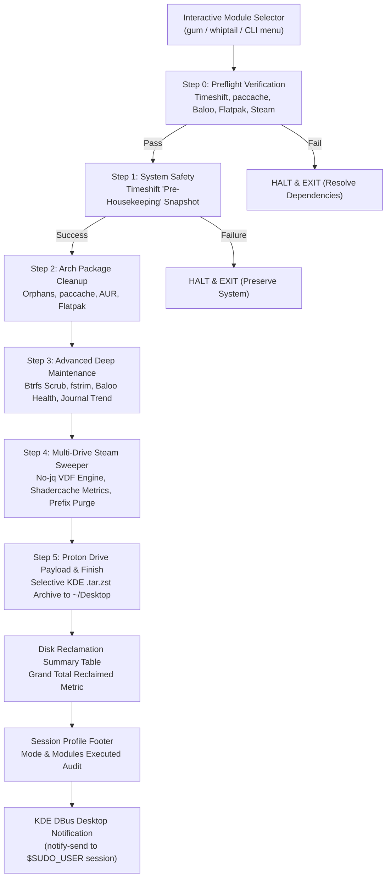

# CachyOS & KDE Plasma Comprehensive Housekeeping Suite

**Version**: `2026.10.13`  
**Author**: Zarrotox  
**Target OS**: CachyOS / Arch Linux with KDE Plasma 6  

**TL;DR:**  
Run `sudo ./cachyos-housekeeping.sh` for an interactive cleanup,  
`--safe-mode` for non-destructive maintenance,  
or `--dry-run` to simulate everything.

A hardened, sysadmin-grade Bash maintenance, performance-tuning, and backup automation suite designed for manual execution via `sudo`.

---

## Table of Contents

- [Changelog](#changelog)
- [Operational Modes: Standard vs Safe Mode vs Dry-Run](#operational-modes-standard-vs-safe-mode-vs-dry-run)
- [Interactive Module Selector](#interactive-module-selector)
- [Advanced System Monitors](#advanced-system-monitors)
  - [A. Journal Growth Monitor](#a-journal-growth-monitor)
  - [B. KDE Baloo Index Fragmentation Check](#b-kde-baloo-index-fragmentation-check)
  - [C. Steam Shadercache Performance Monitor](#c-steam-shadercache-performance-monitor)
- [Prerequisites & Package Requirements](#prerequisites--package-requirements)
- [CLI Options & Usage Guide](#cli-options--usage-guide)
- [Detailed 5-Step Pipeline](#detailed-5-step-pipeline)
  - [Step 1: System Safety (Timeshift Failsafe)](#step-1-system-safety-timeshift-failsafe)
  - [Step 2: Arch Package Cleanup](#step-2-arch-package-cleanup)
  - [Step 3: Advanced Deep Maintenance (Btrfs, Baloo, Journal)](#step-3-advanced-deep-maintenance-btrfs-baloo-journal)
  - [Step 4: Multi-Drive Steam Orphan Sweeper (No-jq Engine)](#step-4-multi-drive-steam-orphan-sweeper-no-jq-engine)
  - [Step 5: Proton Drive Payload & Notifications](#step-5-proton-drive-payload--notifications)
- [Log Files & Telemetry](#log-files--telemetry)
- [Creating a Convenient Terminal Alias](#creating-a-convenient-terminal-alias)

---

## Changelog

### v2026.10.13
- **Interactive Module Selector**: Added multi-select dialogs via `gum`, `whiptail`, or interactive CLI fallback to choose which cleanup tasks to run.
- **Safe Mode (`-s` / `--safe-mode`)**: Strictly disables all `rm -rf` operations while permitting non-destructive actions (Timeshift, Btrfs scrub, fstrim, journal vacuum, and backup).
- **Journal Growth Monitor**: Queries `journalctl --disk-usage` before vacuuming and logs usage with ISO timestamps for trend analysis.
- **Baloo Fragmentation Check**: Inspects file counts and database allocations in `~/.local/share/baloo/` to detect LMDB storage fragmentation.
- **Steam Shadercache Monitor**: Measures and logs `du -sh` on shader caches across all detected library paths for performance tuning.
- **CLI Options**: Added `--all`, `--modules <list>`, `--safe-mode`, and `--version` flags.

### v2026.10.12
- Integrated live disk space tracking using `du` block allocations and outputting a Grand Total summary table.
- Added native KDE Plasma DBus desktop alerts via `sudo -u "$SUDO_USER" notify-send`.
- Hardened script with `set -euo pipefail`, `${var:?}` deletion barriers, and dual logging via `tee`.

---

## Operational Modes: Standard vs Safe Mode vs Dry-Run

The suite provides 3 execution modes:

```
┌─────────────────┬───────────────────┬──────────────────┬─────────────────┐
│ Feature         │ Standard Mode     │ Safe Mode (-s)   │ Dry-Run (-d)    │
├─────────────────┼───────────────────┼──────────────────┼─────────────────┤
│ Timeshift       │ Creates snapshot  │ Creates snapshot │ Simulated       │
│ Btrfs Scrub     │ Executes          │ Executes         │ Simulated       │
│ SSD fstrim      │ Executes          │ Executes         │ Simulated       │
│ Journal Vacuum  │ Executes          │ Executes         │ Simulated       │
│ Config Backup   │ Creates .tar.zst  │ Creates .tar.zst │ Simulated       │
│ rm -rf Actions  │ Active            │ BLOCKED          │ Simulated       │
│ Package Prune   │ Active            │ BLOCKED          │ Simulated       │
└─────────────────┴───────────────────┴──────────────────┴─────────────────┘
```

> [!TIP]
> **Safe Mode** is for "real maintenance, zero deletions" runs. If you're ever unsure, use this.

1. **Standard Mode**: Full automated cleanup with pre-run Timeshift safety snapshot.
2. **Safe Mode (`--safe-mode`)**: Executes all health and maintenance operations, but strictly blocks any `rm -rf` or file deletions.
3. **Dry-Run Mode (`--dry-run`)**: Simulates all operations, displaying projected reclaimable space without modifying disks.

---

## Interactive Module Selector

When launched without `--all` or `--modules`, an interactive checklist prompts you to choose which modules to run:

- `[ ] Pacman cleanup` (orphaned dependencies and package cache trimming)
- `[ ] AUR cleanup` (paru and yay build and clone caches)
- `[ ] Flatpak cleanup` (unused runtimes and extensions)
- `[ ] KDE cleanup` (Baloo reset, Kdenlive proxy/scratch caches, thumbnails)
- `[ ] Steam cleanup` (abandoned multi-drive Proton prefixes and shader caches)
- `[ ] Btrfs scrub` (root scrub and SSD TRIM discard commands)
- `[ ] Backup` (selective configuration archive to `~/Desktop`)

The selector automatically detects **`gum`** or **`whiptail`**, falling back to a numbered CLI prompt if neither is installed.

---

## Advanced System Monitors

### A. Journal Growth Monitor
Before vacuuming logs to 2 weeks, the script evaluates journal growth:
```bash
journalctl --disk-usage
```
The output is displayed in the terminal and timestamped into `/var/log/cachyos-housekeeping.log` for trend analysis:
```
[2026-10-13T10:50:00-05:00] [JOURNAL-TREND] Pre-vacuum disk usage: Archived and active journals have 450.0M.
```

### B. KDE Baloo Index Fragmentation Check
Baloo's LMDB index stores large items under `index` and splits smaller records into `index-<n>`. The script directly detects LMDB fragmentation by probing for split files:
```bash
frag_count=$(find "$baloo_dir" -maxdepth 1 -type f -name "index-*" | wc -l)
```
If `frag_count > 20` or database size exceeds 500 MB, fragmentation is confirmed and a clean index rebuild is triggered.

### C. Steam Shadercache Performance Monitor
Before cleaning orphaned files, the script evaluates every discovered Steam library:
```bash
du -sh "$lib/steamapps/shadercache"
```
Logs shader storage consumption across each physical mount to `/var/log/cachyos-housekeeping.log` for gaming performance tuning.

---

## Prerequisites & Package Requirements

| Utility | Package | Purpose |
|---|---|---|
| **Timeshift** | `timeshift` | System snapshots before maintenance (Btrfs or rsync mode) |
| **pacman-contrib** | `pacman-contrib` | Provides `paccache` for pruning old package versions |
| **zstd & tar** | `zstd`, `tar` | High-speed compression for configuration backups |
| **AUR Helper** | `paru` or `yay` | Cleans AUR build and clone caches |
| **KDE Plasma 6** | `baloo`, `libnotify` | `balooctl6` indexer control and `notify-send` desktop alerts |
| **Interactive UI** *(optional)* | `gum` or `whiptail` | Interactive checklist module selector |

Install missing packages:
```bash
sudo pacman -S --needed timeshift pacman-contrib zstd tar libnotify gum
```

---

## CLI Options & Usage Guide

```
Usage: sudo ./cachyos-housekeeping.sh [OPTIONS]

Options:
  -d, --dry-run          Simulate all actions without modifying or deleting files.
  -s, --safe-mode        Prevent any 'rm -rf' or destructive deletions while executing
                         safe operations (Timeshift, btrfs scrub, fstrim, journal vacuum, backup).
  -a, --all              Execute all modules without prompting the module selector.
  -m, --modules <LIST>   Comma-separated list of modules to run.
                         Available: pacman, aur, flatpak, kde, steam, btrfs, backup
  -v, --version          Print script version and exit.
  -h, --help             Display this help message and exit.
```

### Common Usage Examples

```bash
# 1. Interactive mode with module selector dialog
sudo ./cachyos-housekeeping.sh

# 2. Run in Safe Mode (zero deletions)
sudo ./cachyos-housekeeping.sh --safe-mode

# 3. Complete Dry-Run simulation
sudo ./cachyos-housekeeping.sh --dry-run

# 4. Run all modules unattended without prompts
sudo ./cachyos-housekeeping.sh -a

# 5. Run only specific modules (e.g. pacman and steam)
sudo ./cachyos-housekeeping.sh -m pacman,steam
```

---

## Detailed 5-Step Pipeline



### Step 0: Preflight Dependency & System Verification
Fails early with actionable error messages before modifying any system state:
- Verifies `timeshift` executable is present.
- Verifies `pacman-contrib` (`paccache`) if `pacman` module is active.
- Verifies `balooctl6` or `balooctl` if `kde` module is active.
- Verifies `flatpak` binary if `flatpak` module is active.
- Verifies Steam library manifest exists (`libraryfolders.vdf`) if `steam` module is active.

### Step 1: System Safety (Timeshift Failsafe)
Always runs prior to cleanup modules to ensure rollback protection. If snapshot creation fails, the script immediately exits.

### Step 2: Arch Package Cleanup
- **Pacman**: `pacman -Qtdq` orphan detection and `paccache -rk2` trimming.
- **AUR**: Prunes `paru` and `yay` caches.
- **Flatpak**: Uninstalls unused runtimes (`flatpak uninstall --unused -y`).

### Step 3: Advanced Deep Maintenance (Btrfs, Baloo, Journal)
- **Journal**: Records `journalctl --disk-usage` before vacuuming to 2 weeks.
- **Coredumps**: Empties `/var/lib/systemd/coredump/*`.
- **Baloo**: Evaluates fragmentation and index size; conditionally runs `suspend` $\rightarrow$ `purge` $\rightarrow$ `check` only if corrupt or bloated (>500MB).
- **Caches**: Wipes Kdenlive proxies and thumbnail cache.
- **Btrfs Scrub & SSD TRIM**: Runs `btrfs scrub start -Bd /` and `fstrim -av`.
- **Pacnew Scan**: Searches `/etc` for `.pacnew` / `.pacsave` files.

### Step 4: Multi-Drive Steam Orphan Sweeper (No-jq Engine)
- Parses `libraryfolders.vdf` with pure `sed` and `awk`.
- Measures shadercache storage size across every drive for gaming performance analysis.
- Scans `appmanifest_<AppID>.acf` across libraries to build an installed game array.
- Deletes uninstalled numerical AppID folders in `compatdata/` (abandoned Proton prefixes) and `shadercache/`.

### Step 5: Proton Drive Payload & Notifications
- Archives `~/.config`, shell RCs (`.bashrc`, `.zshrc`), and lightweight KDE folders (`konsole`, `plasma`, `kxmlgui5`, `kxmlgui6`, `kdenlive`, `color-schemes`, `dolphin`, `applications`), avoiding heavy game/Steam directories.
- Saves to `~/Desktop/CachyOS-Config-Backup-YYYY-MM-DD.tar.zst`.
- Prints the **Disk Reclamation Summary Table** accompanied by the **Session Profile Footer** (`Mode: ...` and `Modules executed: ...`) and logs it to `/var/log/cachyos-housekeeping.log`.
- Sends a native desktop alert to the active KDE session via `notify-send`.

---

## Log Files & Telemetry

Full execution logs, journal trends, and shader metrics are appended to:
```bash
/var/log/cachyos-housekeeping.log
```

For long‑term use, consider adding this log to your system's `logrotate` configuration (e.g. `/etc/logrotate.d/cachyos-housekeeping`).

---

## Creating a Convenient Terminal Alias

Add these aliases to your `~/.bashrc` or `~/.zshrc`:

```bash
alias cachy-clean="sudo bash '$HOME/cachyos-housekeeping/cachyos-housekeeping.sh'"
alias cachy-safe="sudo bash '$HOME/cachyos-housekeeping/cachyos-housekeeping.sh' --safe-mode"
alias cachy-dry="sudo bash '$HOME/cachyos-housekeeping/cachyos-housekeeping.sh' --dry-run"
```

Reload your shell:
```bash
source ~/.bashrc   # or source ~/.zshrc
```
